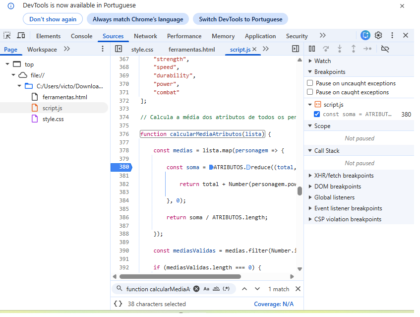

# Marvel Universe

## Tema do projeto

O Marvel Universe é um site desenvolvido com o tema dos personagens da Marvel, permitindo explorar heróis e vilões, pesquisar personagens, favoritar personagens e utilizar ferramentas interativas.

## Integrantes e responsabilidades
Victor Luis Soares Brito

## Tecnologias utilizadas

- HTML5
- CSS3
- JavaScript
- Git e GitHub

## APIs utilizadas

### Superhero API

Endpoint utilizado:

`https://akabab.github.io/superhero-api/api/all.json`

Método HTTP: GET.

Utilizado para buscar os dados dos personagens, incluindo nome, editora, alinhamento, primeira aparição, imagens e atributos.

Os dados são filtrados para exibir somente personagens cuja editora seja Marvel Comics.

### JSONPlaceholder

Endpoint utilizado:

`https://jsonplaceholder.typicode.com/posts`

Método HTTP: POST.

Utilizado para simular o envio dos dados do formulário de contato.

**Observação:** o JSONPlaceholder simula o envio e não armazena mensagens em uma caixa de entrada real.

## Evidências do Debugging

### Breakpoint na função calcularMediaAtributos

A imagem abaixo mostra o código pausado durante a execução,
com o painel Scope aberto no DevTools.

